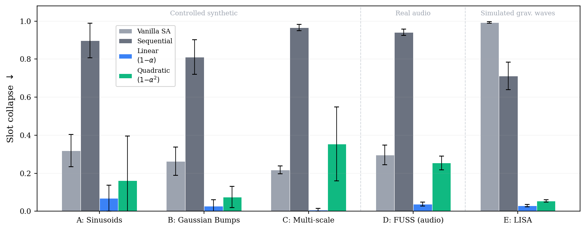

# When Attention Collapses

Code for the NeurIPS 2026 paper

> **[When Attention Collapses: Residual Evidence Modeling for Compositional Inference](https://arxiv.org/abs/2605.02323)**<br>
> Niklas Houba. *NeurIPS 2026.* [arXiv:2605.02323](https://arxiv.org/abs/2605.02323)

Slot attention is effective at grouping tokens into objects, but it can struggle with additive
mixtures (audio, overlapping spectra, gravitational-wave data), where several sources contribute to
the same token: one strong source tends to capture several slots while the weaker ones are never
picked up. We call this slot
collapse. Evidence depletion is a small change to slot attention that counters it: slots are
processed one after another, each token keeps a scalar evidence `e ∈ [ε, 1]` that shrinks as slots
attend to it, and a `γ log e` term in the attention logits pushes later slots toward tokens that
have not been explained yet.

<p align="center">
  
  <br><em>Fig. 1 of the paper: slot collapse (lower is better) for vanilla, sequential, and linear
  and quadratic evidence-depletion attention. Peak overlap, except LISA (cosine overlap). This
  repository covers the synthetic and FUSS groups.</em>
</p>

This repository provides the evidence-depletion module, the baselines from the paper, and
reproduction scripts for the synthetic and FUSS experiments. The LISA experiments use a separate
simulation and training pipeline, described in Appendix A of the paper.

## Installation

```bash
git clone https://github.com/nhouba/when-attention-collapses.git
cd when-attention-collapses
python -m venv .venv && source .venv/bin/activate
pip install -e ".[plot]"        # or ".[dev,plot]" for tests and linting
```

This needs Python 3.10 or newer, PyTorch ≥ 2.1, NumPy and SciPy. `requirements.txt` has the exact
versions we tested with; those pins need Python 3.12 or newer, so on 3.10/3.11 just use
`pip install -e .`. Everything runs on a CPU. The synthetic models are small enough that they train
faster on a single CPU core than on a GPU; for the FUSS experiments a GPU is recommended.

## Using the module

```python
import torch
from evidence_depletion import EvidenceDepletionSlotAttention

attn = EvidenceDepletionSlotAttention(
    n_slots=5,
    d_model=64,
    n_iter=3,  # refinement iterations per slot
    gamma=3.0,  # weight of the log-evidence bias
    tau=0.3,  # attention temperature
    depletion="linear",  # "linear", "quadratic", "cubic" or "binary"
)
tokens = torch.randn(8, 16, 64)  # [batch, tokens, dim], e.g. encoder output
out = attn(tokens)
out.slots  # [B, S, D]
out.attn  # [B, S, L], each slot's attention over tokens
out.evidence  # list of S+1 tensors [B, L], evidence before and after each slot
```

In training mode the slot order is shuffled; in `eval()` mode slots run in a fixed order. `slots`
and `attn` are indexed by slot, `evidence` by processing step. Since the slot order carries no
meaning, train with a permutation-invariant loss. Hungarian matching is the usual choice (the paper's
LISA model uses it). The synthetic and FUSS benchmarks instead match sources to the top-K slots
greedily, both in the training loss and in the evaluation.

The default `depletion="quadratic"` is the form written in Eq. 6 and Algorithm 1 of the paper and
used for the LISA experiments, so the module matches the paper's reference formulation. For new
problems we recommend starting with `"linear"`, which gave the lowest collapse on the synthetic and
FUSS benchmarks (App. J).

`build_model(method, ...)` builds the full model used in the benchmarks (tokenizer, slot attention,
parameter and existence heads) for every method in the paper: `vanilla`, `sequential`,
`evidence_{linear,quadratic,cubic,binary}`, `dataspace_*`, `mesh`, `sa_sh`, `sparsemax`, `entmax15`,
`coverage`, `coverage_loss`, `stickbreaking` and `dspn`.

`examples/quickstart.py` trains vanilla, sequential and evidence-depletion attention for a few
epochs on sinusoid mixtures and prints the collapse on held-out data. It runs in under a minute on
a laptop:

```bash
python examples/quickstart.py
```

### Practical considerations

- The method helps when one source dominates. With equal or nearly equal amplitudes (ratio ≤ 1.5)
  it is not reliably better than vanilla slot attention (App. I).
- The temperature matters more than `gamma`. With `tau = 0.3`, collapse stayed low for `gamma` in
  {1, 3, 10}; `tau = 1.0` washes out the bias, and `tau = 0.1` is unstable unless `gamma` is large
  (App. E, sinusoids).
- Slots run sequentially, so the critical path is O(S·I) instead of O(I). At S = 5 that was about
  4× slower than vanilla attention on a GH200 (App. I).

## Reproducing the paper

Run everything from the repository root. The script defaults are the paper settings (200 epochs,
5,000 training and 1,000 test mixtures). Results are appended to a JSON file in the output
directory, and runs that are already there are skipped; pass `--no-resume` to rerun them.

We don't ship trained models. A synthetic model takes a few minutes to train on a CPU and a FUSS
model about an hour on a GPU, and the per-seed numbers behind the paper are in `results/paper/`.

To check your setup, run

```bash
bash scripts/reproduce/quick_check.sh
```

It trains on sinusoids with a reduced budget (40 epochs, 3 seeds) and takes 5–7 minutes on a laptop
CPU. Our run gave a peak overlap of 0.38 for vanilla and 0.15 for evidence depletion. Exact values
depend on hardware and PyTorch version, so the script only checks that evidence depletion is below
half of vanilla.

The full reproduction is split by paper artifact. GPU-hours are for one NVIDIA GH200 running jobs
one after another. The synthetic runs are so small that a GPU spends most of its time on kernel
launches (20–30 min per 200-epoch run, against 3–6 min on one CPU core), so running many CPU jobs
in parallel is the fastest option.

| Paper artifact | Script | GH200 GPU-h (serial) |
|---|---|---|
| Fig. 1 and Table 1 (synthetic), App. F, App. G, data-space variants | `scripts/reproduce/fig1_table1_synthetic.sh` | ~52 |
| Table 2: alternative mechanisms and matching pursuit | `scripts/reproduce/table2_alternatives.sh` | ~50 |
| App. E: sensitivity to γ and τ | `scripts/reproduce/app_e_sensitivity.sh` | ~13 |
| App. H: loss-based baselines | `scripts/reproduce/app_h_loss_baselines.sh` | ~38 |
| App. I: amplitude ratio, slot and token counts, slot order, latency | `scripts/reproduce/app_i_stress.sh` | ~87 |
| FUSS: Table 1 and Table 8 columns, Table 13, App. J | `scripts/reproduce/fuss.sh` | ~25 |
| All of the above | `scripts/reproduce/all.sh` | ~265 |

`docs/reproduce.md` gives the command behind every number in the paper, how seeds are aggregated
(mean ± population std), the expected values, and the few places where the released code and the
reported numbers differ. `scripts/make_tables.py` turns finished runs into the paper's tables:

```bash
python scripts/make_tables.py results/runs
```

For FUSS, `bash experiments/download_fuss.sh` downloads the dataset (Zenodo record 3743844,
CC BY 4.0) to `data/fuss/ssdata`, which is the default `--fuss-dir` of `experiments/fuss.py`.

## Results

The core comparison from Table 1: peak overlap (Definition 1), mean ± std over 5 seeds, lower is
better. Numbering follows the camera-ready version of the paper; the FUSS column differs slightly
from arXiv v1 (see `docs/reproduce.md`, Sec. 15).

| Method | Sinusoids | Gaussians | Multi-scale | FUSS |
|---|---|---|---|---|
| Vanilla slot attention | 0.32 ± 0.09 | 0.26 ± 0.07 | 0.22 ± 0.02 | 0.30 ± 0.05 |
| Sequential slot attention | 0.90 ± 0.09 | 0.81 ± 0.09 | 0.97 ± 0.02 | 0.94 ± 0.02 |
| Evidence depletion (linear) | **0.07 ± 0.07** | **0.03 ± 0.03** | **0.01 ± 0.01** | **0.04 ± 0.01** |

Comparisons with the alternative attention mechanisms and the loss-based baselines are in Table 2
and Appendix H of the paper and in `docs/reproduce.md`; `results/paper/` has all reported numbers.

Peak overlap measures how attention is allocated rather than how accurately sources are recovered.
The paper also evaluates parameter recovery and, on FUSS, source separation (App. J); the scripts
for these are listed in `docs/reproduce.md`.

## Layout

```
src/evidence_depletion/
  attention.py      evidence-depletion slot attention
  baselines.py      vanilla, sequential and the alternative mechanisms
  models.py         tokenizers, heads, build_model
  metrics.py        collapse metrics and parameter recovery
  training.py       training and evaluation loops
  separation.py     attention-to-mask readout and SI-SDR (App. J)
  data/             synthetic generators and the FUSS loader
experiments/        command-line scripts for each experiment (App. D checks in app_d/)
scripts/            reproduction scripts and table generation
results/paper/      the paper's numbers, per seed where available
examples/           quickstart
tests/
```

## Tests

```bash
pip install -e ".[dev,plot]"
pytest
```

This takes about a minute on a CPU. The tests cover output shapes for every method, the evidence
staying in [ε, 1] and never increasing (Proposition 2), each depletion form, permutation
equivariance over tokens, and a one-epoch run of every experiment script. There are also 133 tests
that compare this code against the original research code and check that both give bit-identical
results (for every method except SA-SH, which we reimplemented). They need the research code,
which is not distributed, and are skipped unless `ED_REFERENCE_CODE` points to it.

## Citation

```bibtex
@inproceedings{houba2026attention,
  title         = {When Attention Collapses: Residual Evidence Modeling for Compositional Inference},
  author        = {Houba, Niklas},
  booktitle     = {Advances in Neural Information Processing Systems},
  year          = {2026},
  eprint        = {2605.02323},
  archivePrefix = {arXiv}
}
```

## License

MIT, see [LICENSE](LICENSE). FUSS is distributed by its authors under CC BY 4.0.

This work was funded by the Gravitational Physics Professorship at ETH Zurich.
